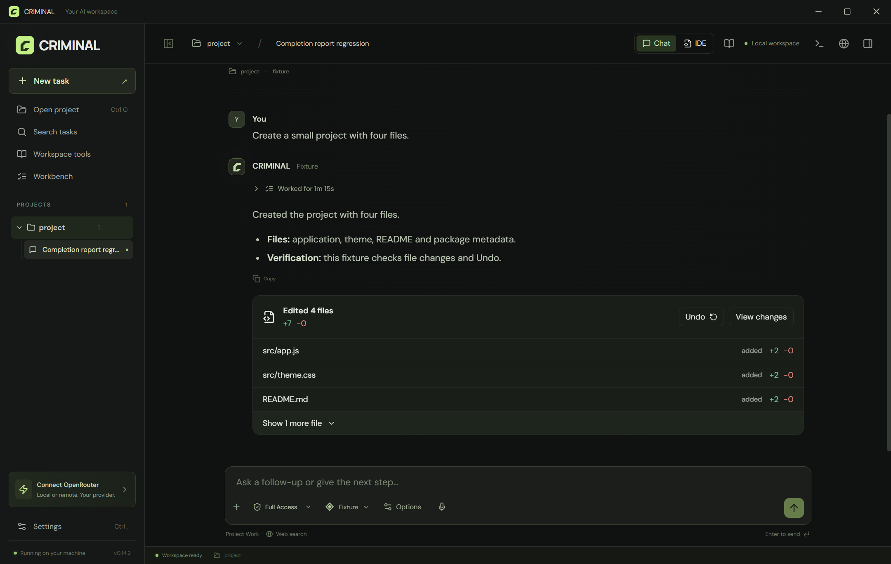
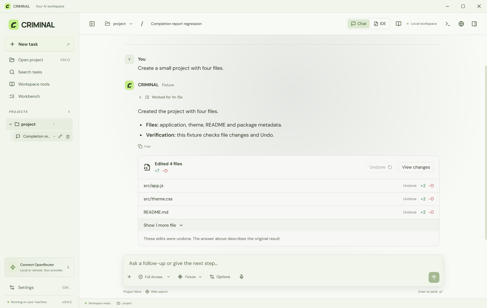

# CRIMINAL

**A free AI workspace for Windows. Bring your models and work in your own project folders.**

Published by **BhojpuriyaDon** · **v0.22.0** · Windows x64 · Installer and portable editions

[Releases](https://github.com/BhojpuriyaDon/CRIMINAL/releases) · [Report an issue](https://github.com/BhojpuriyaDon/CRIMINAL/issues) · [License](LICENSE.txt)

CRIMINAL is a desktop app for coding, research, document work and automation. Choose a project folder and an AI model, describe a task, and let the agent read files, make changes, run commands and check its work.

**The app is free for personal and commercial use.** Bring your own provider account or local model. Paid APIs and cloud services charge separately; CRIMINAL does not include API credits.

This repository hosts downloads, documentation and issue reports. CRIMINAL's application source code is not published here. CRIMINAL is an independent project, not an OpenAI product, and does not require a ChatGPT subscription.

## Preview



*CRIMINAL 0.14.2 using a demonstration project.*

<details>
<summary>View the light theme</summary>



</details>

## Download

**Latest release: [CRIMINAL 0.22.0](https://github.com/BhojpuriyaDon/CRIMINAL/releases/tag/v0.22.0)**

Choose an edition:

| Edition | What to download |
| --- | --- |
| Installer | [Download Windows installer](https://github.com/BhojpuriyaDon/CRIMINAL/releases/download/v0.22.0/CRIMINAL-Setup-0.22.0.exe) — installs the app and creates shortcuts. |
| Portable | [Download portable app](https://github.com/BhojpuriyaDon/CRIMINAL/releases/download/v0.22.0/CRIMINAL-0.22.0-portable.exe) — opens without installation. |
| Checksums | [SHA256SUMS.txt](https://github.com/BhojpuriyaDon/CRIMINAL/releases/download/v0.22.0/SHA256SUMS.txt) |
| Third-party licenses | [Legal and covered-source bundle](https://github.com/BhojpuriyaDon/CRIMINAL/releases/download/v0.22.0/CRIMINAL-0.22.0-third-party-legal.zip) |

GitHub's automatically generated "Source code" ZIP/TAR downloads contain this documentation repository, not the application.

Close older CRIMINAL instances before upgrading. The current build is unsigned, so Windows may show an unrecognized-publisher warning. Obtain downloads from this repository and compare them with the checksums supplied for the release.

License documents are available in **Settings → License**, including an **Open license folder** button. Each release also supplies a third-party legal ZIP containing license notices and the covered source archives for MPL components.

Portable describes how the executable launches; it does not mean all settings stay beside the executable. The app stores settings and history in the Windows user profile, separately from your selected project folders.

## Get started

1. Install or open CRIMINAL on a Windows x64 PC.
2. Open **Settings**, configure your provider and test the connection.
3. Select a model, click **New task** and choose a project folder.
4. Use **Project Work** to create or change files, or **Chat only** for conversation.
5. Describe your task. Review the final summary, changed files and verification results.

Example:

```text
Build a task manager in this folder with a clean interface.
Add create, edit and delete actions, test them, and summarize the changes.
```

English, Hindi and Hinglish prompts are supported. Results depend on the selected model and its capabilities.

## What's new in 0.22.0

- **Direct provider presets:** 34 endpoint presets cover hosted APIs, regional/deployment endpoints and local servers; OpenRouter remains optional.
- **Connection setup:** presets fill the endpoint, protocol, authentication guidance and setup links. Saved profiles remain separate; unsaved key/model drafts clear on preset changes.
- **Model discovery:** manual model/deployment IDs are supported where provider catalogs differ, including Azure. Custom provider profiles remain available.
- **Compatibility:** direct profiles support OpenAI Chat Completions, OpenAI Responses, Anthropic Messages and Gemini. Other signing/OAuth APIs need a compatible gateway.

**Release verification:** 685 automated tests passed, including 38 provider tests. The packaged provider desktop suite and portable executable checks passed. Tests used fixtures; paid live-provider calls and a clean Windows VM installation were not tested. Windows packages are unsigned.

[Direct AI provider setup](docs/AI_PROVIDERS.md) explains how to connect supported hosted, regional and local APIs.

## What's new in 0.21.0

- **Task controls:** ask separately, queue the next request or steer the current run. Stop, failure and restart pause pending work.
